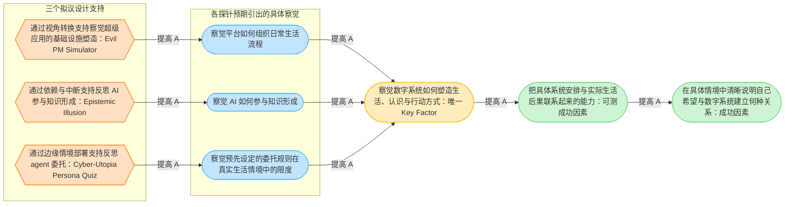

# Impact Model v2（中文版）

这张图有 **一个 Key Factor、三个 supports**。这是合理的：三个作品采用不同机制，但都希望作用于同一个核心问题。六边形写的是每个 support 的功能；作品名称放在功能后，方便课堂辨认。

`A` 是 assumption（设计假设）；在 DRM 图中可写成 `[A]`。为兼容 Miro Mermaid 的版本，预览代码显示为 `A`。
