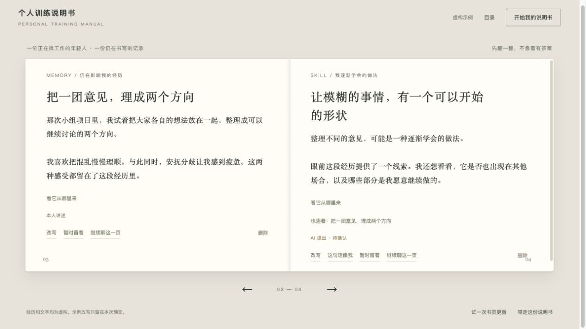

# Personal Training Manual / 个人训练说明书

A thesis research prototype combining guided reflection in Codex with a local, editable book-page display. The “trained by the world” metaphor connects experiences, learned approaches, recurring habits and sources of support through **Memory, Skill, Loop and Tool**. The manual also leaves room for priorities, questions and participant-defined categories.

This is an early design prototype. The sample content and engineering checks use synthetic material. Human-participant evaluation and relevant professional review remain future research work.



## Run locally

Requires Node.js 20 or later; no application dependencies or separate model API key are needed. The reflection conversation runs in the user's existing Codex environment and uses its applicable allowance.

```sh
cd prototype/personal-training-manual
node book/server.mjs
```

Open the `Local` address printed by the server. On macOS, `book/启动书页.command` also starts the local service and opens the page.

The opening book is a clearly marked fictional sample. It supports page turning, source excerpts, related-page navigation, editing, acceptance, leaving a question open, deletion and Markdown export. Sample changes are temporary.

## Connect a Codex conversation

Install the five skills and configure this local book's location:

```sh
node book/install-skills.mjs
```

This updates the following same-named directories in `~/.codex/skills/`; back up personal modifications first. Unrelated skills are untouched:

- `personal-training-manual`
- `ptm-explore-experience`
- `ptm-work-and-values`
- `ptm-repair-conversation`
- `ptm-build-manual`

Start a new Codex conversation with `$personal-training-manual`. The host explains the first-edition outcome, offers concrete starting points and asks once about local saving. Once a useful experience is available, it creates a new book with real initial pages and opens its exact URL using available browser tools. No manual session-ID handoff is needed. Chat-only use remains available. A browser-opening failure falls back to the saved book's link; a saving failure must be reported separately.

At meaningful points, the skill updates the same draft through its configured helper and `book/bookctl.mjs`. The page checks for updates approximately every 1.4 seconds. It does not read the Codex conversation stream or automatically import earlier chats. Moving an existing book to another conversation is still possible with the page's optional continuation message.

## Records and controls

Personal books are stored only in `book/data/sessions/`, which is ignored by Git. Local runtime information is under `book/.runtime/`, also ignored. The server binds to `127.0.0.1`; there is no public deployment or multi-user account system.

The updater checks revision conflicts, provenance links and protected participant edits. A page explicitly accepted or rewritten in the browser cannot be silently replaced by an AI update. Deleting a page removes its saved excerpts and cross-links, without creating an old-version backup; other page wording and platform chat history are unaffected.

Only prototype source, mechanism notes and clearly marked synthetic examples belong in this repository. Separate research use of any participant material requires its own authorization and institutional process.

## Check the implementation

```sh
cd book
node --test tests/*.test.mjs
```

The tests cover server bootstrapping, atomic first-edition creation, continuation of the same book, session isolation, protected edits, revision conflicts, source validation, deletion and record-path boundaries. They do not establish clinical suitability or reflective effectiveness.

To stop the locally running service:

```sh
node book/stop.mjs
```

## Design and research notes

- [Start using the mechanism](00_开始使用.md)
- [Conversation mechanism](01_机制设计.md)
- [Sources and design decisions](02_文献依据与设计决策.md)
- [Test scenarios](03_测试情境与验收.md)
- [Pilot-study plan](04_先导试用与研究记录.md)
- [Mechanism check record](05_本轮检查记录.md)
- [Book-page guide](06_书页原型_使用说明.md)
- [Book-page check record](07_书页原型_检查记录.md)

The mechanisms adapt ideas from prior reflective-interaction and career/narrative research; see the source notes for attribution and evidence limits. Skills are guidance for a model, not a guarantee that every future response follows the intended behavior.
